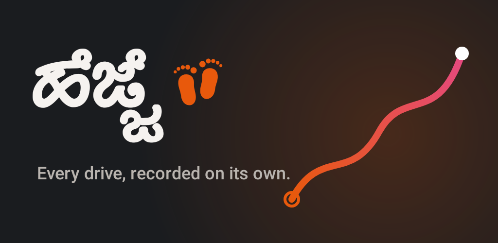
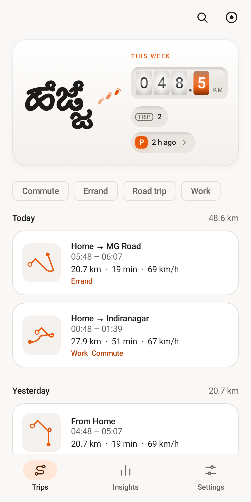
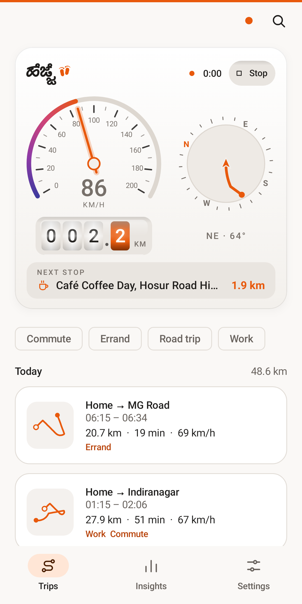
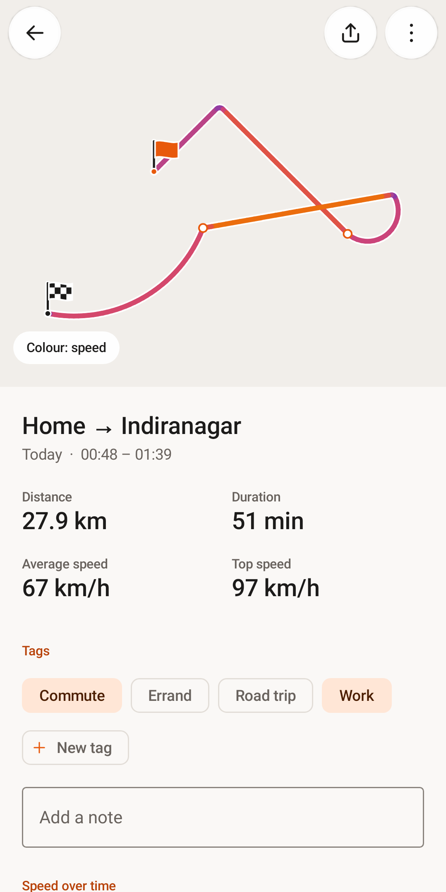
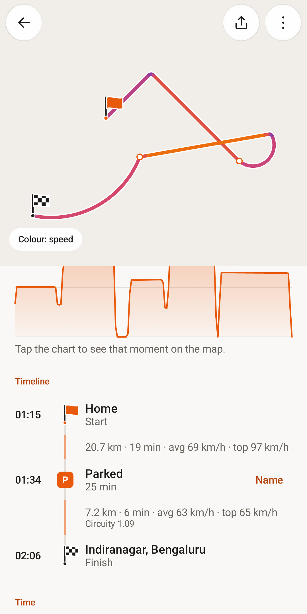
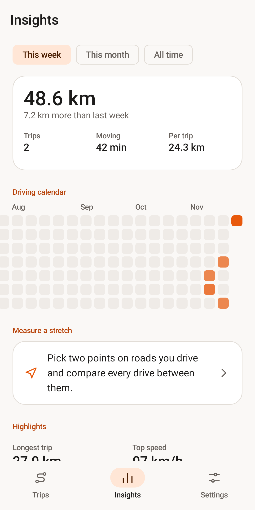
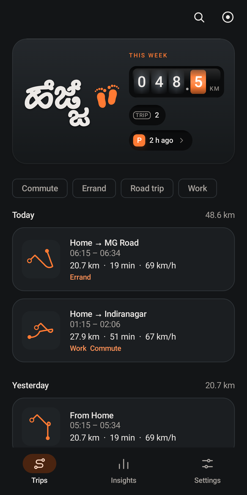
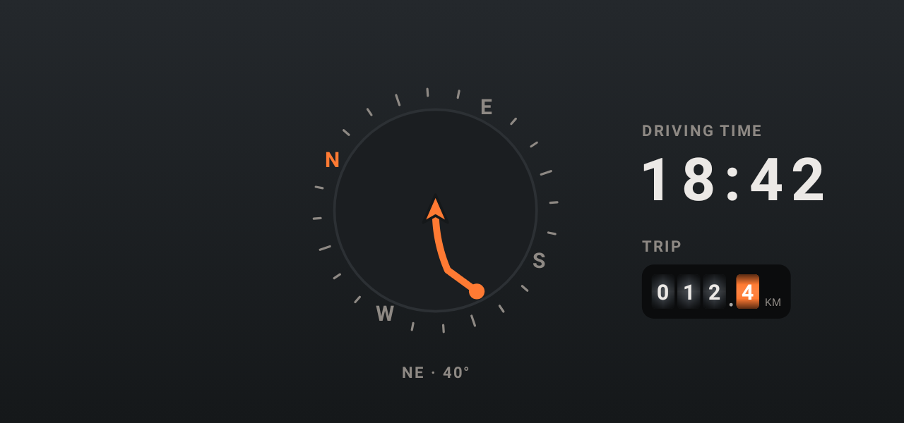

<p align="center">
  
</p>

# Hejje Guruthu (ಹೆಜ್ಜೆ ಗುರುತು)

**Every drive, recorded on its own.** Get in the car and Hejje starts recording. Get out and the trip is saved: route, distance, time, speed and where you parked. You never have to open it.

*Hejje Guruthu* means "footprints" in Kannada.

<p align="center">
  
  
  
</p>

## What it does

**Records by itself**
- Starts when your phone connects to the car's Bluetooth and stops when it disconnects.
- Works with the phone in your pocket and the app closed.
- Prefer to tap? Use the Start button or the "Record drive" Quick Settings tile.

**Feels like a dashboard**
- A live instrument cluster while you drive: a speedometer up to 200 that changes colour with speed, a compass, a rolling odometer and your next stop.
- Speed comes from GPS plus the phone's motion sensors, so it reacts fast and reads zero when you've stopped.

**Every trip, in detail**
- A map of the route, coloured by speed.
- A timeline of the drive: start, stops along the way, finish.
- A speed chart. Tap any moment to see where you were.
- Tags (Commute, Errand, Road trip, Work, or your own), notes and search.
- A picture of the trip to share, with private places hidden.

**Insights**
- Totals for this week, this month and all time.
- A driving calendar and highlights such as your longest trip, top speed and streaks.
- **Measure a stretch:** pick two points on a road you drive often and compare every drive between them.

**Stop reminders**
- Name a stop after you park: food, coffee, or whatever you like.
- On later drives Hejje tells you when one is coming up, by notification, voice or not at all.

**Parked car**
- Shows where you left the car and how long ago.

**Android Auto**
- Your saved stops on the car screen, the next one on your route first. Tap one to navigate there.
- A compass, driving time and trip distance drawn on the map.

**Replay video**
- Turn any trip into a short vertical video, made on your phone: a satellite view of your route with the real sky of that hour (night, sunrise, sunset) and the real weather.
- The camera glides low over the start, each highlight and the arrival and rises over long empty stretches, so a short hop takes a few seconds and a long road trip about twenty.
- Share it or save it to your gallery. Private places are cut out, as in share cards.

**Home-screen widget**
- This week's kilometres on a little odometer, right on your home screen.

<p align="center">
  
  
  
</p>

<p align="center">
  
</p>

## Private by design

- No account, no ads, no tracking. Your trips stay on your phone.
- **Private places:** add Home, Work and more. Routes near them are always hidden on shared pictures and GPX files, and can be hidden in the app too.
- The only things that leave the phone: map tiles, and (if "Look up place names" is on) start and end points sent to OpenStreetMap to find their names.
- Export everything to one file, import a backup or GPX, or delete it all from Settings.

Full details: [Privacy policy](PRIVACY.md).

## Get it

- **Google Play:** coming soon.
- **Now:** download the APK from [Releases](https://github.com/usr-canis/hejje/releases).

Needs Android 8.0 or newer with Google Play services. During setup, allow location ("Allow all the time") and Bluetooth so drives can start on their own.

Works in kilometres or miles, light or dark.

## Build it

Kotlin and Jetpack Compose. With JDK 21 and the Android SDK installed:

```sh
./gradlew assembleDebug        # debug APK
./gradlew testDebugUnitTest    # tests, including the screenshots in app/build/screens
```

The wordmark ಹೆಜ್ಜೆ uses the Mallige font (GPL v2, see [`third_party/mallige`](third_party/mallige)).
